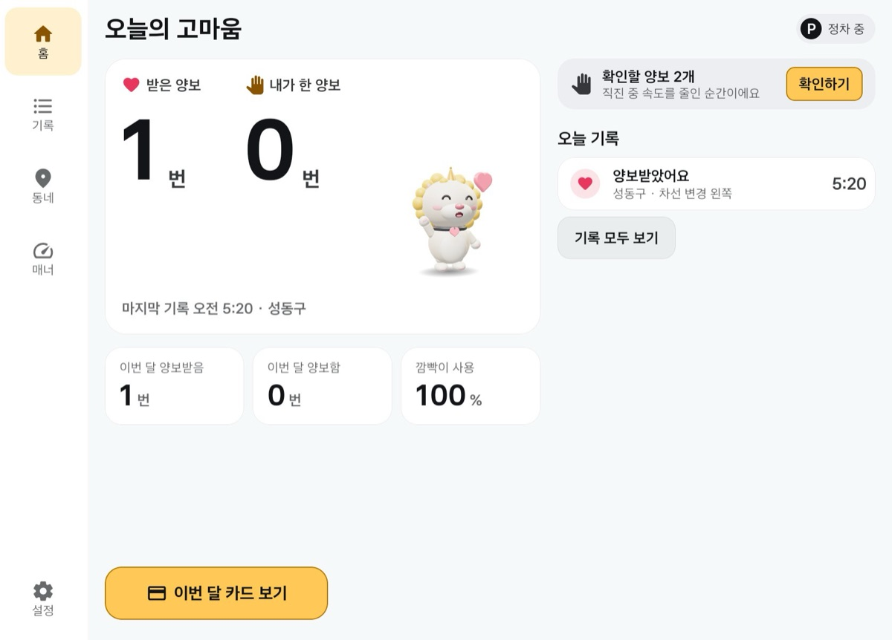
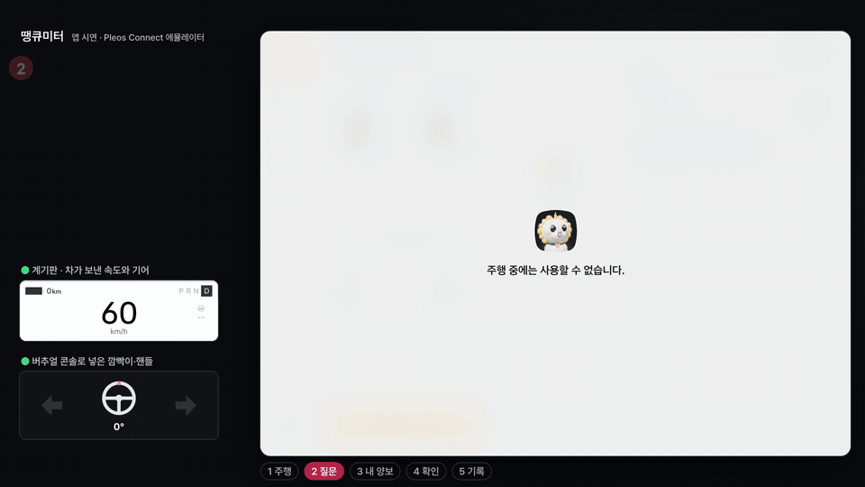
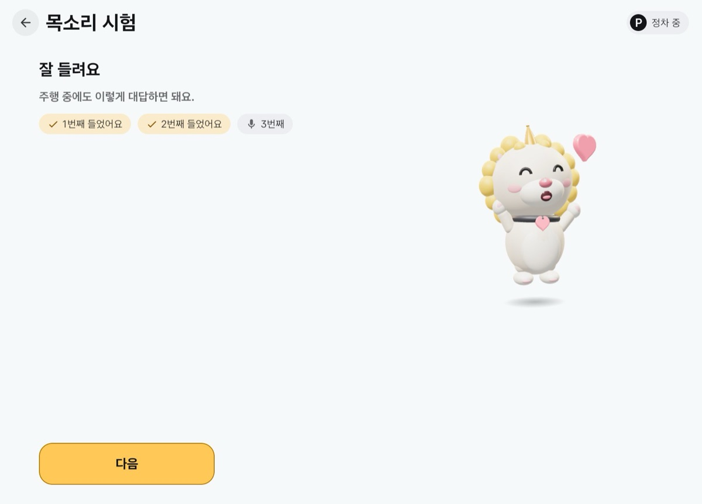
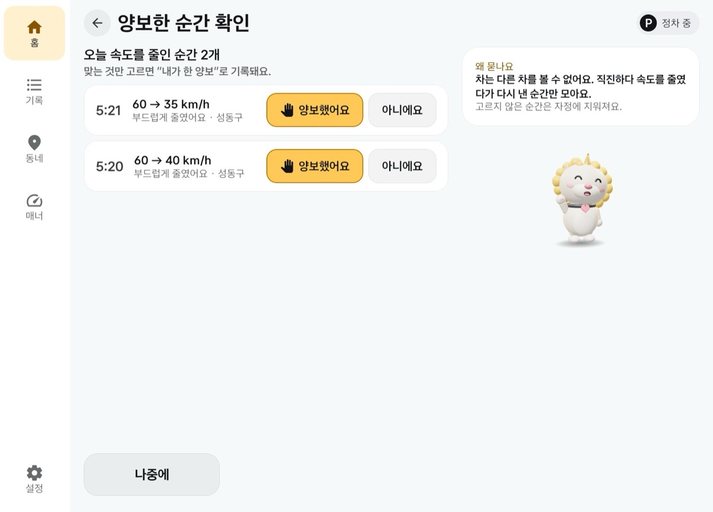
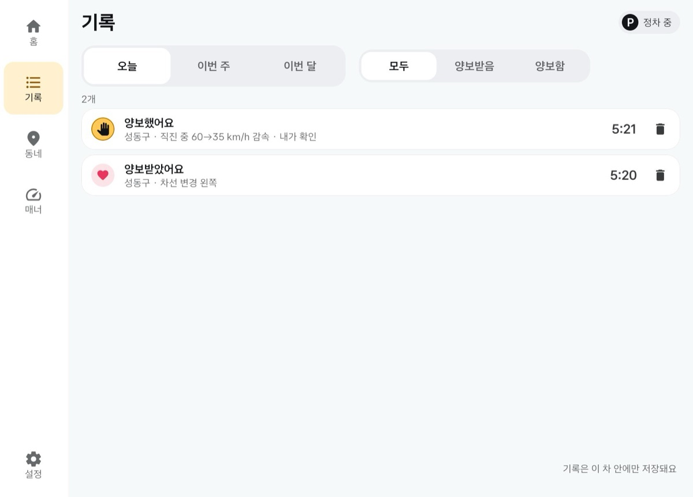
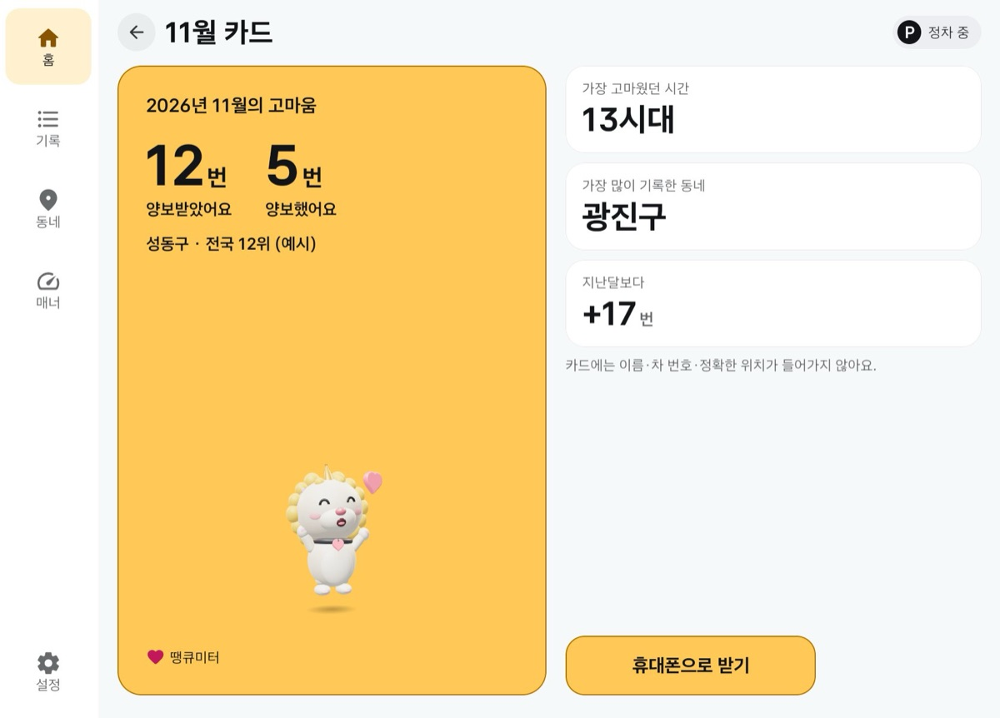
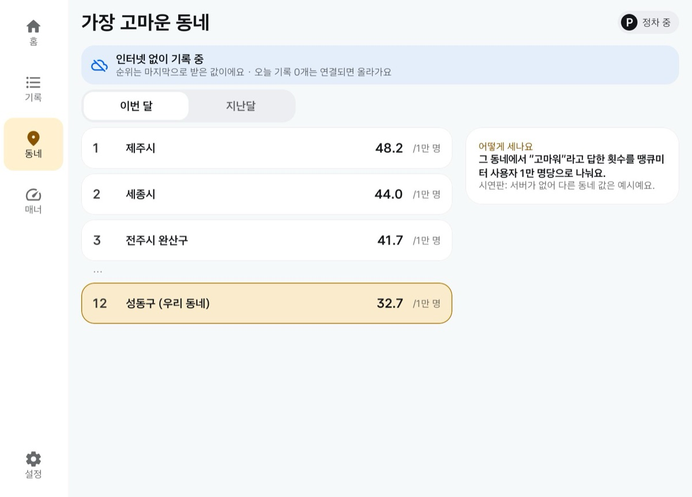
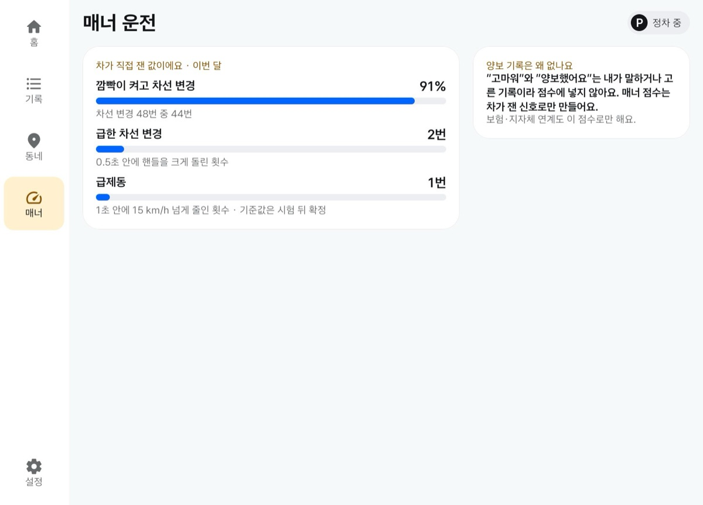
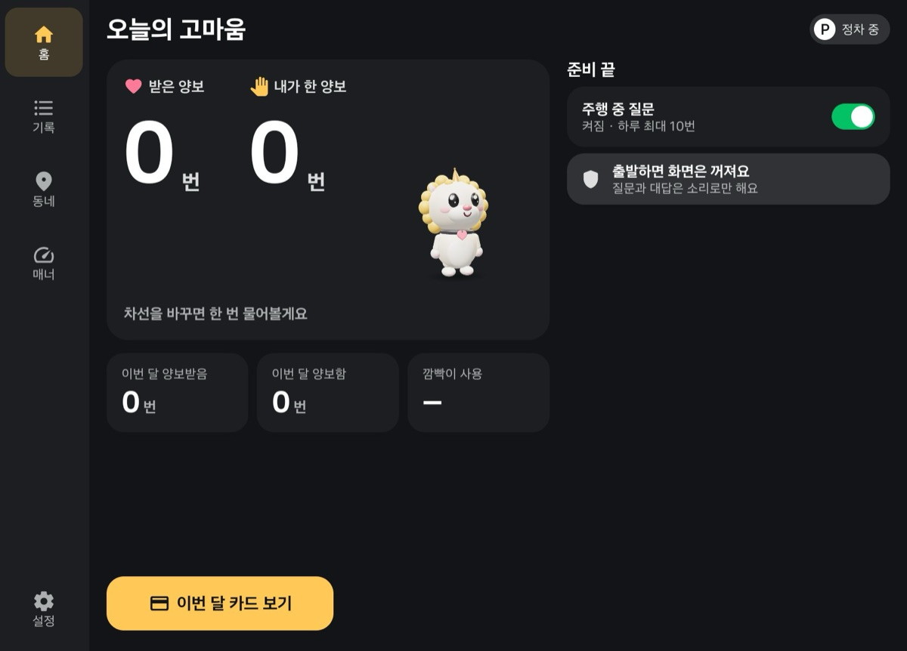

# 땡큐미터 Thank-you Meter

**양보받은 고마운 순간을 모아 동네를 잇는 앱.** 차선을 바꾼 뒤 차가 "양보받았어요?"라고 한 번 묻고, 운전자는 "고마워" 한 마디로 그 순간을 남깁니다. 주행 중 화면은 쓰지 않습니다. 남은 고마움은 월간 카드, 우리 동네 순위, 차가 잰 매너 기록이 됩니다.

현대자동차그룹 차량용 앱 개발 공모전(Pleos Connect) 출품작 · 팀 Haechi



## 시연 영상

[](docs/media/thankyou-meter-demo.mp4)

**[전체 시연 영상 보기 (약 1분, mp4)](docs/media/thankyou-meter-demo.mp4)**

Pleos Connect 에뮬레이터에서 실제로 실행한 화면과 소리입니다. 왼쪽에는 차가 보낸 속도·기어와 버추얼 콘솔로 넣은 깜빡이·핸들 각도를 함께 보여 줍니다. 속도를 바꾸지 않았고, 기다리는 구간만 잘라 냈습니다. 운전자의 "고마워"는 시험 입력입니다.

1. **주행** — P단 홈에서 D단으로. 주행 중에는 Pleos가 앱 화면을 가리고, 60 km/h로 오른쪽 차선 변경
2. **질문** — 차선 변경을 마치면 알림음과 함께 "양보받았어요?" → "고마워" → "확인했어요"
3. **내 양보** — 직진 중 60 → 38 km/h로 줄였다가 다시 가속한 순간을 조용히 후보로 모음
4. **확인** — P단 홈에 "확인할 양보 1개", 그 순간을 보고 「양보했어요」
5. **기록** — 기록, 11월 카드, 가장 고마운 동네(예시 데이터), 매너 운전

## 빠르게 보기

| | |
|---|---|
| APK | [`apk/Haechi_ThankYouMeter_release.apk`](apk/Haechi_ThankYouMeter_release.apk) — 출시 빌드(R8 축소, 릴리스 서명, 19 MB, v1.0.0) |
| 시험 환경 | Pleos Connect Emulator v2.1.0 (Android API 34, arm64), 버추얼 콘솔 |
| 필요한 설정 | 권한 자동 부여 설치(`-g`). 말로 답하려면 에뮬레이터 Extended controls → Microphone에서 호스트 오디오 입력을 켬 |
| 개발 환경 | JDK 17, Android SDK 34, Kotlin + Jetpack Compose |

**실행 3단계**

```bash
# 1. Pleos Connect 에뮬레이터를 Cold boot로 켠다 (Quick boot면 차량 기능이 동작하지 않음)
# 2. APK 설치 (권한 자동 부여)
adb install -r -g apk/Haechi_ThankYouMeter_release.apk
# 3. 버추얼 콘솔에서 기어를 P로 두고, 앱 목록에서 "땡큐미터" 실행
```

첫 실행에서 권한을 허용하고 목소리 시험("고마워"를 두 번)을 하거나 건너뛰면 홈입니다. 이어서 버추얼 콘솔에서:

1. 기어 **D**, 속도 **60 km/h**
2. 오른쪽 깜빡이를 켜고 핸들을 오른쪽으로 조금 돌렸다가 반대로 되돌려 직진, 깜빡이 끄기
3. 약 4.5초 뒤 "양보받았어요?" → 5초 안에 "고마워"라고 말하면 "확인했어요"
4. 30초 뒤 속도를 40 km/h 아래로 줄였다가 다시 60으로 → 기어 P → 홈의 "확인할 양보"

**직접 빌드**

```bash
./gradlew :app:assembleDebug                 # 디버그(시험 방송 포함)
./gradlew :app:assembleRelease               # 출시(R8). 서명 키가 없으면 디버그 키로 서명됨
adb install -r -g app/build/outputs/apk/debug/app-debug.apk
```

출시 APK는 에뮬레이터 기본 흐름 시험(`python3 e2e/release_smoke.py`, 20항목)을 통과했습니다: 설치·첫 실행, 차량·음성 SDK 연결, 차선 변경 감지, 소리 질문과 5초 듣기, 대답이 없으면 기록하지 않음, 감속 후보, P단 확인, 월간 카드, 크래시 없음. 디버그 빌드가 설치돼 있으면 서명이 달라 먼저 지워야 합니다(`adb uninstall app.thankyoumeter`).

## 무엇을 하나

땡큐미터의 기능은 고마움이 오가는 방향을 따릅니다.

| | 기능 | 설명 |
|---|---|---|
| ♥ | 받은 고마움 | 깜빡이를 켠 차선 변경이 끝나면 한 번 "양보받았어요?". "고마워", "땡큐", "응"이면 기록. 되묻지 않음 |
| ✋ | 건넨 고마움 | 직진 중 5초 안에 10 km/h 넘게 줄였다가 다시 가속한 순간을 후보로 모으고, 정차 뒤 「양보했어요 / 아니에요」로 고름 |
| ▤ | 기록 | 오늘·이번 주·이번 달, 받은 것·한 것으로 나눠 보기, 지우기와 되돌리기 |
| ▣ | 월간 카드 | 이번 달 받은 수·한 수, 가장 고마웠던 시간대와 동네. QR로 휴대폰에 받아 나누기. 이름·차 번호·정확한 위치는 넣지 않음 |
| ⌖ | 가장 고마운 동네 | 시군구 단위, 사용자 1만 명당 "고마워" 수로 매달 순위(지금은 예시 데이터) |
| ◔ | 매너 운전 | 깜빡이를 켜고 바꾼 비율, 급한 차선 변경, 급제동. 모두 차가 직접 잰 값 |

## 화면

| | |
|---|---|
|  **첫 실행 목소리 시험** — "고마워"를 두 번 말해 차 안에서 잘 들리는지 확인 |  **홈(P단)** — 받은 양보·내가 한 양보, 확인할 양보 띠, 오늘 기록, 깜빡이 사용률 |
|  **양보한 순간 확인** — 차가 잰 감속(60 → 35 km/h)을 보고 고름 |  **기록** — 기간과 종류로 나눠 보기 |
|  **월간 카드** — 이번 달의 고마움 한 장, 휴대폰으로 받기 |  **가장 고마운 동네** — 인터넷이 없으면 마지막 순위와 안내 |
|  **매너 운전** — 차가 잰 깜빡이 사용률·급한 차선 변경·급제동 |  **밤 테마** — 낮·밤 테마, 가로 전체와 두 앱 분할(세로 840) 지원 |

화면은 Pleos Connect 에뮬레이터 실제 실행 화면에서 앱 영역만 자른 것입니다.

## 왜 차에서만

| | 휴대폰 앱 | 땡큐미터 |
|---|---|---|
| 언제 기록하나 | 운전자가 기억해 두었다가 나중에 직접 입력 | 차가 차선 변경·감속의 순간을 알아채고 그때만 묻거나 모아 둠 |
| 무엇으로 아나 | GPS와 가속도 추정 | 차의 깜빡이, 핸들 각도, 속도, 기어 |
| 어떻게 답하나 | 화면을 보고 누름 | 화면 없이 말 한마디. 주행 중 화면 0 |
| 점수의 근거 | 휴대폰 센서 추정 | 차가 잰 깜빡이 사용률·급한 차선 변경·급제동 |

## 안전 설계

Pleos 주행 안전 가이드가 화면 입력보다 음성을 우선하라고 한 것을 따랐습니다.

- **주행 중 화면 0.** 앱 화면은 P단에서만 씁니다. 주행 중 앱을 열면 Pleos가 화면을 가립니다.
- **묻는 순간을 좁게.** 깜빡이를 켠 차선 변경(핸들을 한쪽으로 돌렸다가 되돌려 직진)이 끝난 뒤에만 묻습니다. 교차로 회전(핸들 90도 초과, 평균 30 km/h 미만), 깜빡이만 켠 경우, 깜빡이 없는 차선 변경에는 묻지 않습니다.
- **한 번만, 짧게.** 직진 3초 뒤 1.5초 기다렸다가 묻고 5초만 듣습니다. 대답이 없으면 아무 소리도 내지 않고, 되묻지 않습니다.
- **그만 묻게.** "오늘은 그만"이라고 하거나 세 번 연속 대답이 없으면 그날은 쉽니다. 질문 사이 3분, 하루 최대 10번(3~20번 설정).
- **양보받은 기록은 점수에 쓰지 않음.** 차는 상대가 양보했는지 알 수 없으므로, 매너 점수는 차가 잰 값으로만 만듭니다.
- **소리와 위치를 남기지 않음.** 음성은 기기 안 인식(ON_DEVICE)만 쓰고 소리 원본을 저장하지 않으며, 인식된 글자도 분류 뒤 버립니다. 기록은 기기 안에만 쌓이고 동네는 시군구 단위로만 씁니다.
- **다른 앱 소리를 존중.** 다른 앱이 안내 음성을 내고 있거나 마이크 권한이 꺼져 있으면 묻지 않습니다.

## Pleos SDK 사용

| SDK / API | 쓰는 곳 |
|---|---|
| Vehicle — 방향지시등 `registerTurnSignalState` | 차선 변경 시작·끝, 좌우 판단, 깜빡이 사용률 |
| Vehicle — 조향각 `registerSteeringWheelAngle` | 차선 변경(되돌림)과 회전(90도 초과) 구분, 급한 차선 변경 |
| Vehicle — 기어 `registerGearSelection` | D단에서만 감지·질문, P단에서 확인 화면 |
| AAOS 속도 `PERF_VEHICLE_SPEED` (`CarPropertyManager`) | 회전 제외(30 km/h), 감속 후보, 급제동 |
| TextToSpeech `ON_DEVICE` (`speak`) | "양보받았어요?", "확인했어요", "오늘은 그만 물을게요" |
| SpeechToText `ON_DEVICE` (`request`, `stop`) | 짧은 대답 분류(예·아니·그만) |

SDK 버전: `ai.pleos.playground:Vehicle:2.3.2`, `SpeechToText:3.3.1`, `TextToSpeech:3.3.1`

권한: `pleos.car.permission.CAR_LIGHTS`(방향지시등), `pleos.car.permission.CAR_DRIVE`(기어), `pleos.car.permission.READ_CAR_STEERING`, `android.car.permission.CAR_SPEED`, `android.car.permission.CAR_POWERTRAIN`, `pleos.car.permission.STT_SERVICE`, `pleos.car.permission.TTS_SERVICE`, `android.permission.RECORD_AUDIO`, 포그라운드 서비스(`specialUse|microphone`), 알림, 부팅 완료 수신

## 구조

```
app/src/main/java/app/thankyoumeter/
├── vehicle/Signals.kt      깜빡이·조향·기어(Pleos Vehicle) + 속도(AAOS)
├── detect/Detector.kt      차선 변경·회전 제외·감속 후보·급제동 판정(순수 로직, 단위 시험)
├── detect/DetectService.kt 포그라운드 서비스. 다른 앱을 쓰는 동안에도 감지·질문·기록, 시동 시 다시 시작
├── detect/Asker.kt         묻기 규칙(간격, 하루 최대, 오늘은 그만, 무응답 쉼)
├── voice/Voice.kt          Pleos TTS·STT(ON_DEVICE), 알림음, 대답 분류
├── data/Store.kt           기기 안 저장(기록, 후보, 매너, 설정)
└── ui/                     Compose 화면: 첫 실행, 홈, 확인, 기록, 카드·QR, 동네, 매너, 설정
```

동네 순위와 카드 웹 주소는 지금 기기 안 목업이며, 화면에 "예시"라고 밝혔습니다.

## 시험

- 감지 단위 시험 12개: `./gradlew :app:testDebugUnitTest`
- 에뮬레이터 자동 시험 167개 항목(첫 실행·홈 29, 감지 19, 소리 흐름 24, 홈·기록·확인 33, 카드·동네·매너·설정 36, 통합 26): `python3 e2e/run_all.py`(디버그 빌드, 에뮬레이터와 버추얼 콘솔 필요)
- 출시 APK 기본 흐름 20항목: `python3 e2e/release_smoke.py`

## 알려진 한계

- **받은 양보는 자기 신고입니다.** 차에는 주변 차량을 보는 SDK가 없어 상대가 양보했는지 알 수 없습니다. 그래서 점수와 보험 근거로 쓰지 않습니다.
- **실차 신호는 아직 확인하지 못했습니다.** 원터치 깜빡이, 실차의 조향 부호, 차선 변경·회전의 실제 핸들 각도 분포는 에뮬레이터와 공개 자료로 정했습니다. 기준값은 실차 기록으로 다시 맞춥니다.
- **차 안 소음 속 인식률**은 측정 중입니다. 대답은 선택이고, 못 들으면 아무 일도 일어나지 않습니다.
- **동네 순위와 카드 주소는 목업**입니다. 집계 서버는 다음 단계입니다.

## 개발 참여 (팀)

이 저장소의 커밋은 팀 이름 `Haechi`와 noreply 메일로만 남깁니다. 받은 직후 첫 커밋 전에 이 저장소에만 설정합니다(`--global`을 쓰지 마세요).

```bash
git config user.name  "Haechi"
git config user.email "225294644+Vyblor@users.noreply.github.com"
git config core.hooksPath .githooks     # 푸시 전 익명 검사
tools/check-authors.sh                  # OK가 나오면 준비 끝
```

- 커밋은 PC에서만 합니다. GitHub 웹에서 고치면 계정 메일로 커밋됩니다.
- 실명·개인 메일·회사명을 코드, 문서, 커밋 메시지에 쓰지 않습니다.
- Pleos 개발 약관에 따라 SDK 바이너리를 풀거나 역분석하지 않습니다.
- 기획과 기록: [docs/thankyou-meter.md](docs/thankyou-meter.md), 감지 설계 [docs/detection-design.md](docs/detection-design.md), 스프린트 [docs/sprints.md](docs/sprints.md), 플랫폼 사실 [docs/pleos-platform.md](docs/pleos-platform.md)

## 라이선스와 출처

- 글꼴: Asta Sans (SIL Open Font License 1.1, [docs/AstaSans-OFL.txt](docs/AstaSans-OFL.txt))
- 캐릭터 해치는 팀이 만들었고, 알림음은 앱이 코드로 합성합니다(`AudioTrack`).
- Pleos SDK는 Pleos 개발자 약관을 따릅니다.
